# TownLoop

**Borrow from next door, not from a store.**

TownLoop lets verified residents of a township lend tools, share spaces and find help from neighbours on their own street. Residents sign in with SDP PRIME, so every account is a real resident from day one, and the money they spend stays in the township.

A student concept for the Sime Darby Property University Hackathon 2026 (Township of Tomorrow).

* **Live demo:** https://rafiarsya07.github.io/Sime-Darby-Hackathon/demo/
* **Design preview:** https://rafiarsya07.github.io/Sime-Darby-Hackathon/
* **App source:** [`townloop/`](townloop) (Next.js 16, React 19, Tailwind CSS 4)

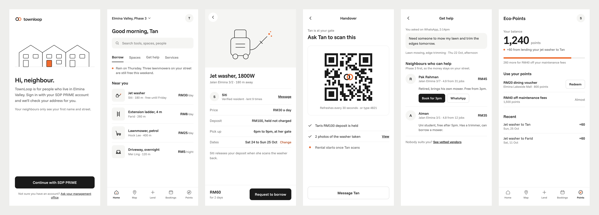

## How it works

1. **Scan at the clubhouse.** A resident scans the QR poster, signs in with SDP PRIME and their address is checked on the spot.
2. **List or find something.** Lend a jet washer, book a BBQ pit, or ask a neighbour to mow the lawn.
3. **Hand over at the gate.** The borrower scans the owner's QR code, the deposit is held and the rental starts.
4. **Give it back.** Scan again on return, the deposit is released and both sides earn Eco-Points.

## User flow

| Sign in | Home | Booking |
|:---:|:---:|:---:|
| 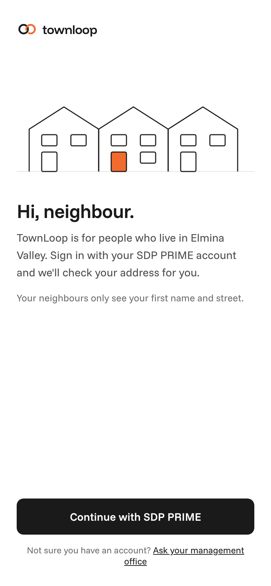 | 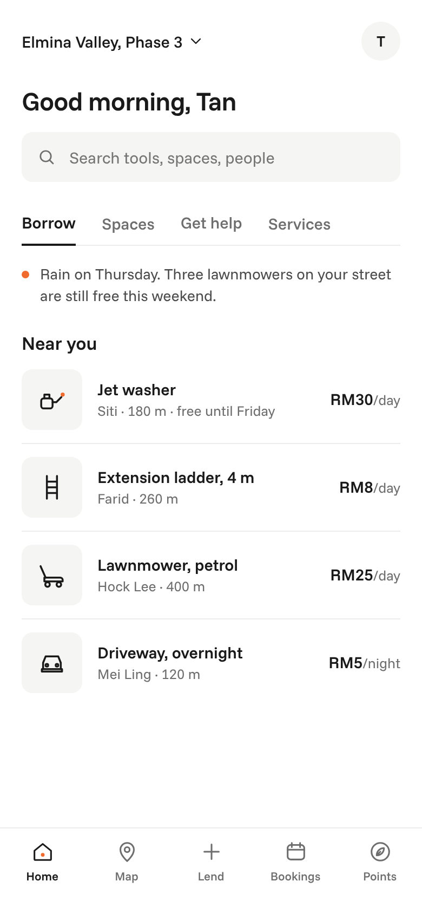 | 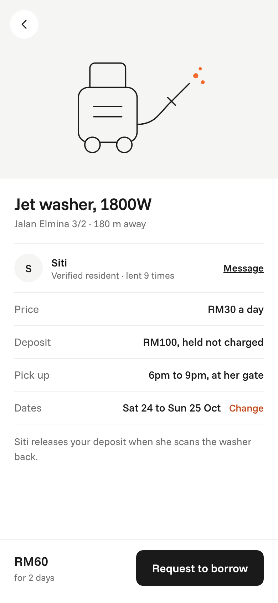 |
| Siti scans the clubhouse poster and signs in with SDP PRIME | Tan browses tools, spaces and help near him | Tan books Siti's jet washer for the weekend |

| QR handover | Get help | Eco-Points |
|:---:|:---:|:---:|
| 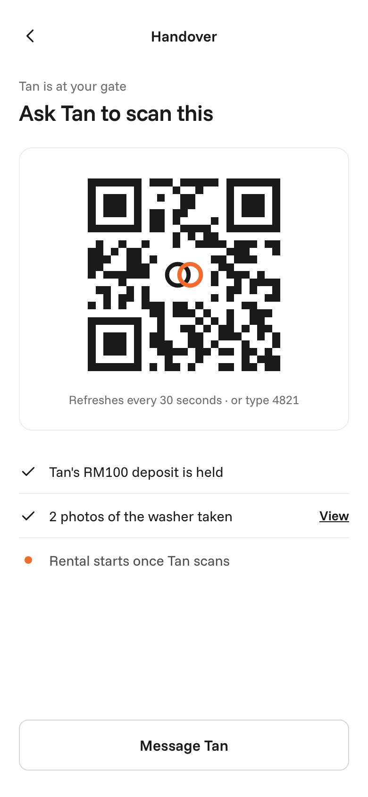 | 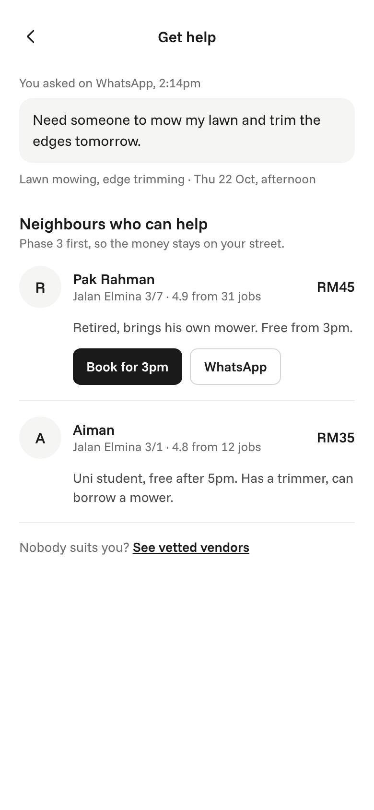 | 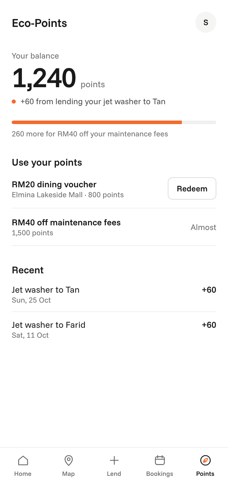 |
| Tan scans Siti's QR at the gate, deposit is held | Tan finds a neighbour to mow his lawn | Siti redeems points for vouchers or maintenance fees |

## Website

| Desktop | Mobile |
|:---:|:---:|
| 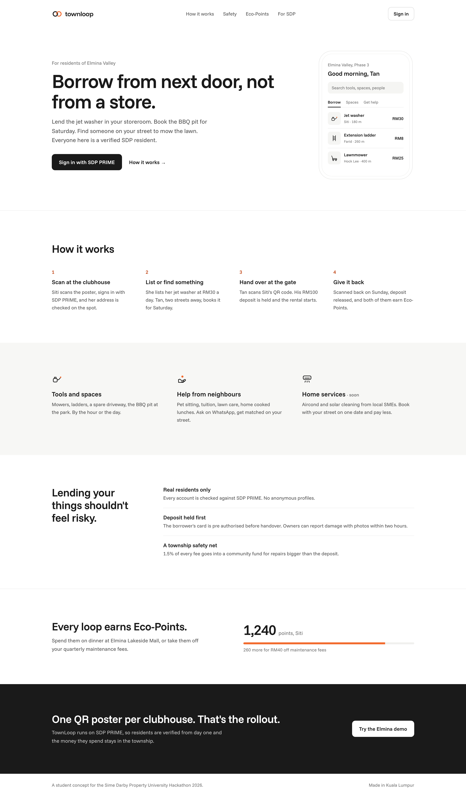 | 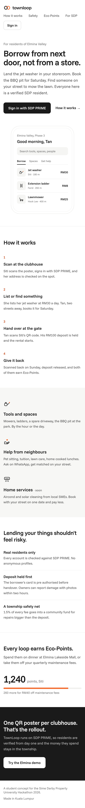 |

## Brand

| Moodboard | Custom icons |
|:---:|:---:|
| 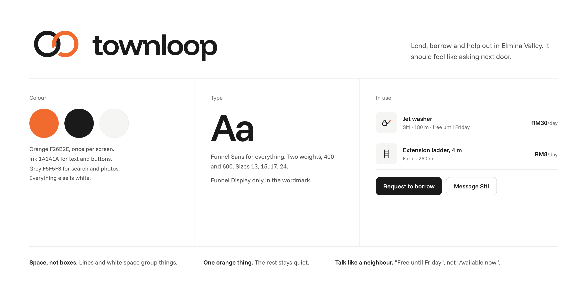 | 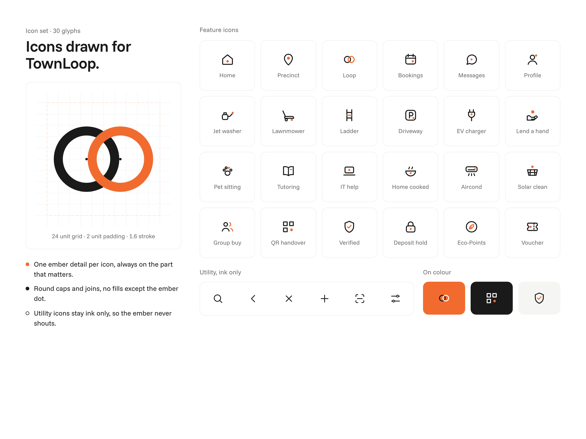 |

## Status

Design stage. All files in [`design/`](design/) are static previews. Source code will be added to this repo as we build.

## Team

Built for the Sime Darby Property University Hackathon 2026.
